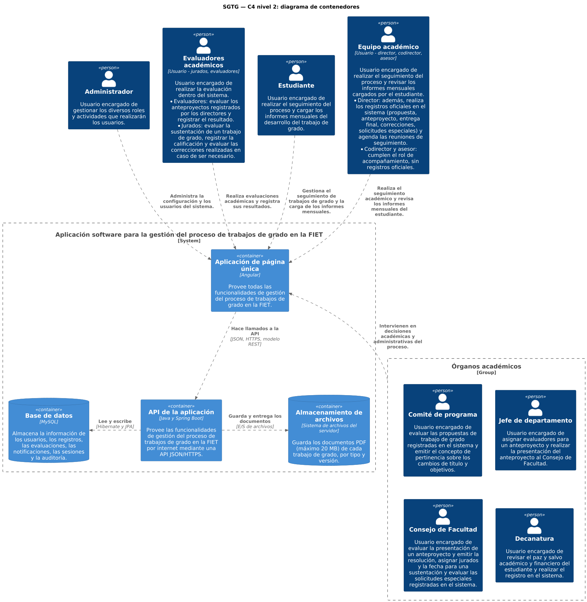

# SGTG · FrontEnd

FrontEnd del **Sistema de Gestión de Trabajos de Grado (SGTG)** de la Facultad de Ingeniería Electrónica y
Telecomunicaciones (FIET) de la Universidad del Cauca. Es una aplicación de página única en Angular que acompaña
todo el proceso de un trabajo de grado, desde la propuesta hasta la sustentación, según el reglamento de trabajos
de grado de la Facultad.

Este repositorio contiene la interfaz. El backend (API REST en Spring Boot) está en
[sgtg_backend](https://github.com/SBenitezL/sgtg_backend).

> Trabajo de grado en modalidad de práctica profesional: *FrontEnd de las funcionalidades asociadas al prototipo
> de aplicación web para la Facultad de Ingeniería Electrónica y Telecomunicaciones, dedicada a los módulos de
> gestión de trabajos de grado.*

## Contenido

- [Funcionalidades](#funcionalidades)
- [Tecnologías](#tecnologías)
- [Arquitectura](#arquitectura)
- [Estructura del proyecto](#estructura-del-proyecto)
- [Requisitos](#requisitos)
- [Puesta en marcha](#puesta-en-marcha)
- [Scripts](#scripts)
- [Pruebas y calidad](#pruebas-y-calidad)
- [Seguridad](#seguridad)
- [Documentación](#documentación)
- [Autor](#autor)

## Funcionalidades

| Módulo | Qué permite |
|---|---|
| **Autenticación** | Inicio de sesión con correo institucional, cambio obligatorio de la contraseña asignada por un administrador y cierre de sesión. |
| **Bandeja de entrada** | Notificaciones de cada evento del proceso; cada una lleva a la vista donde se atiende. |
| **Propuestas** | Registro y corrección de la propuesta (formato A), concepto de pertinencia del Comité del programa y anulación por el director. |
| **Anteproyectos** | Registro y nuevas versiones, asignación de evaluadores por el jefe de departamento, conceptos de los evaluadores (formato B), remisión al Consejo (formato C) y su decisión con el plazo de ejecución. |
| **Trabajos de grado** | Reuniones de seguimiento e informes mensuales, solicitudes especiales (prórroga, suspensión, reanudación, cancelación, cambio de título y objetivos), solicitud y programación de la sustentación, paz y salvo, calificación de los jurados, ajustes y versión definitiva. |
| **Historial** | Consulta de los trabajos cerrados (aprobados, no aprobados o cancelados) con todas sus etapas y documentos. |
| **Estadísticas** | Indicadores y gráficos por estado, etapa, modalidad y programa, con filtros; trabajos próximos a vencer con recordatorio de entrega; reportes en PDF, Excel y CSV. |
| **Usuarios** | Gestión de usuarios, roles, perfiles académicos (departamento o programa) y cambio del Comité del programa. |
| **Formatos descargables** | Formatos oficiales de cada modalidad (trabajo de investigación y práctica profesional). |

Cada usuario ve solo lo que le corresponde según sus roles: estudiante, docente, director, codirector, asesor,
evaluador, jurado, jurado coordinador, Comité del programa, jefe de departamento, Consejo de Facultad, Decanatura
y administrador.

## Tecnologías

| Uso | Tecnología |
|---|---|
| Framework | [Angular](https://angular.dev/) 20 (componentes *standalone*, señales y detección de cambios sin zone.js) |
| Lenguaje | TypeScript 5.9 |
| Componentes de interfaz | [PrimeNG](https://primeng.org/) 20 con el tema Aura y el color institucional |
| Estilos | [Tailwind CSS](https://tailwindcss.com/) 4 y hojas globales con *tokens* de diseño |
| Gráficos | [Chart.js](https://www.chartjs.org/) 4 |
| Reportes | jsPDF y jspdf-autotable (PDF), write-excel-file (Excel) |
| Programación reactiva | RxJS 7.8 |
| Pruebas unitarias y de integración | [Jest](https://jestjs.io/) 30 con jest-preset-angular |
| Pruebas de seguridad | [Playwright Test](https://playwright.dev/) |
| Análisis estático | ESLint 9 con [angular-eslint](https://github.com/angular-eslint/angular-eslint) |
| Servidor web y contenedores | Nginx y Docker Compose |

## Arquitectura

El sistema tiene tres contenedores: esta aplicación, servida por Nginx; la API en Spring Boot y la base de datos
MySQL. Nginx entrega la aplicación y reenvía a la API las peticiones de `/api`, de modo que el navegador usa un
solo dominio.



Dentro del FrontEnd, el backend entrega cada trabajo de grado como un solo registro que avanza por las etapas. La
aplicación lo convierte en tres vistas (propuesta, anteproyecto y trabajo de grado) con el mismo identificador:

```
API REST ──► TrabajoGradoApiService ──► TrabajoGradoStoreService ──► trabajo-grado.mapper ──► TrabajoGradoVistasService
  (HTTP + JWT)   (llamadas al backend)      (señales en memoria,         (respuesta → vistas)      (propuestas, anteproyectos
                                             vigencia de 20 s)                                     y trabajos de grado)
                                                                                                          │
                                                       páginas ◄── fachadas (*-facade.service.ts) ◄───────┘
```

- **Almacén central** (`TrabajoGradoStoreService`): conserva los trabajos en señales, los recarga al navegar
  cuando pasan 20 segundos y reemplaza un trabajo con la respuesta de cada operación, sin volver a pedir la lista.
- **Mapper** (`core/mappers/trabajo-grado.mapper.ts`): traduce el contrato de la API a los modelos de las
  vistas, para que un cambio en el backend se ajuste en un solo lugar.
- **Fachadas**: cada página habla con una fachada que reúne sus servicios, avisos y navegación; los componentes
  solo muestran datos y emiten eventos.
- **Estrategias por pestaña** (`tabs-logic/*.tab.ts`): cada pestaña de documentos cargados define sus columnas,
  filas y acciones según el rol del usuario.
- **Guards e interceptor**: los guards controlan el acceso por sesión, rol y relación con el trabajo; el
  interceptor agrega el token, renueva la sesión ante un 401 y lleva a cambiar la contraseña cuando el backend lo
  exige.

Los diagramas del modelo C4 (contexto, contenedores, componentes de la API y clases del núcleo del FrontEnd) están
en [`docs/diagramas`](docs/diagramas), con su fuente en PlantUML.

## Estructura del proyecto

```
src/app/
├── core/          Servicios transversales: autenticación, almacén de trabajos, mapper, guards,
│                  interceptor, diseños (encabezado, menú lateral) y contrato de la API
├── shared/        Componentes reutilizables (tabla, modales, botones, estados, selector con búsqueda)
│                  y las páginas comunes (evaluaciones realizadas, formatos descargables)
├── modules/       Un módulo por área funcional, cada uno con sus rutas, páginas, componentes y servicios
│   ├── auth/              Inicio de sesión y cambio obligatorio de contraseña
│   ├── notifications/     Bandeja de entrada
│   ├── proposal/          Propuestas
│   ├── preliminary-draft/ Anteproyectos
│   ├── thesis-work/       Trabajos de grado en ejecución y sustentación
│   ├── history/           Historial de trabajos cerrados
│   ├── statistics/        Estadísticas y reportes
│   └── users/             Gestión de usuarios
└── testing/       Datos y utilidades compartidos por las pruebas
```

## Requisitos

- [Node.js](https://nodejs.org/) 22 y npm.
- [Docker Desktop](https://www.docker.com/products/docker-desktop/) para levantar el sistema completo.
- Los dos repositorios como carpetas hermanas:

```
SGTG-Proyecto/
├── sgtg_backend/
└── sgtg_frontend/
```

## Puesta en marcha

### Sistema completo con Docker

`docker-compose.yml` levanta los tres servicios con un solo comando:

| Servicio | Contenido | Puerto |
|---|---|---|
| `web` | Angular compilado servido por Nginx; reenvía `/api` al backend | http://localhost:4200 |
| `backend` | Spring Boot (`../sgtg_backend`) | http://localhost:8080 |
| `mysql` | MySQL 8 | 3307 |

Antes de empezar: Docker Desktop en ejecución, el archivo `sgtg_backend/.env` con el administrador inicial
(copia de `sgtg_backend/.env.example`) y los puertos 4200, 8080 y 3307 libres.

Desde `sgtg_frontend`:

```bash
# Solo la primera vez: crear el .env del backend y ajustar el correo y la clave del administrador
cp ../sgtg_backend/.env.example ../sgtg_backend/.env

# Si estaba corriendo el compose del backend solo, detenerlo (usa los mismos puertos)
docker compose -f ../sgtg_backend/docker-compose.yml down

# Construir y levantar todo
docker compose up --build -d

# Ver el estado y seguir el arranque del backend (listo cuando aparece "Started BackendApplication")
docker compose ps
docker compose logs -f backend

# Detener (conserva la base de datos y los archivos en volúmenes)
docker compose down

# Detener y borrar también los datos (base de datos y PDF)
docker compose down -v
```

Abre http://localhost:4200 e inicia sesión con el administrador del `.env`.

- La base de datos conserva los datos entre reinicios; para empezar de cero, `docker compose down -v`. Los PDF
  quedan en el volumen `archivos_data`.
- Nginx admite peticiones de hasta 65 MB: cada PDF pesa hasta 20 MB y la solicitud de sustentación lleva hasta
  cuatro.

### Desarrollo con recarga en caliente

Con el backend corriendo en el puerto 8080 (por ejemplo, con el `docker compose` de `sgtg_backend`):

```bash
npm install
npm start
```

La aplicación queda en http://localhost:4200 y se recarga al guardar cambios. El proxy de `ng serve`
(`proxy.conf.json`) redirige `/api` a `http://localhost:8080`, así el navegador no hace peticiones a otro origen.

### Producción

El despliegue con HTTPS, secretos fuera del repositorio y copias de seguridad se describe en
[`docs/despliegue-produccion.md`](docs/despliegue-produccion.md) (usa `docker-compose.prod.yml` y
`.env.prod.example`).

## Scripts

| Comando | Qué hace |
|---|---|
| `npm start` | Servidor de desarrollo en http://localhost:4200 |
| `npm run build` | Compilación de producción en `dist/` |
| `npm test` | Pruebas unitarias |
| `npm run test:integration` | Pruebas de integración (`*.integration.spec.ts`) |
| `npm run test:all` | Todas las pruebas; con `-- --coverage` genera el reporte de cobertura en `coverage/` |
| `npm run test:watch` | Pruebas unitarias en modo observación |
| `npm run lint` | Análisis estático con ESLint |
| `npm run test:seguridad` | Los 20 casos de seguridad sobre una copia aislada del sistema en Docker |

## Pruebas y calidad

| Indicador | Resultado |
|---|---|
| Pruebas unitarias | 233 suites, 2.085 pruebas |
| Pruebas de integración | 27 suites, 115 pruebas |
| Cobertura | 96,63 % de sentencias, 84,26 % de ramas, 94,82 % de funciones y 97,47 % de líneas |
| Análisis estático | 0 errores |
| Pruebas de seguridad | 20 de 20 casos aprobados |

- Las **pruebas unitarias** verifican cada servicio, fachada, mapper, guard y componente por separado, incluidos
  los datos inválidos, las respuestas vacías y los errores del servidor.
- Las **pruebas de integración** recorren los flujos completos de cada etapa (por ejemplo, el ciclo de
  evaluación del anteproyecto o la sustentación), con el backend simulado por `HttpTestingController` o por
  servicios simulados.
- Las **pruebas de seguridad** son de caja negra: levantan el sistema en Docker y comprueban el control de
  acceso, la sesión, las contraseñas, la carga de archivos y la auditoría por la interfaz, por el API y en la base
  de datos. Ver [`scripts/pruebas-seguridad`](scripts/pruebas-seguridad/README.md).

El código se documenta con JSDoc según el [estándar de documentación](docs/estandar-documentacion.md) del
proyecto.

## Seguridad

- El token de acceso dura 15 minutos y vive solo en memoria. La sesión se renueva un minuto antes de que venza con
  un token de renovación que el backend guarda en una cookie `HttpOnly`, `Secure` y `SameSite=Strict`.
- La sesión se cierra tras 30 minutos sin actividad.
- Los guards impiden entrar por URL a vistas de otro rol o de trabajos ajenos; el backend vuelve a validar cada
  operación.
- La contraseña que asigna un administrador debe cambiarse en el primer inicio de sesión, y la política de
  contraseñas se valida mientras se escribe.
- Nginx agrega las cabeceras de seguridad (CSP, `X-Frame-Options`, `X-Content-Type-Options`, entre otras) y
  limita los intentos de inicio de sesión por dirección IP.

## Documentación

| Documento | Contenido |
|---|---|
| [`docs/diagramas`](docs/diagramas) | Modelo C4: contexto, contenedores, componentes de la API y clases del núcleo del FrontEnd |
| [`docs/despliegue-produccion.md`](docs/despliegue-produccion.md) | Despliegue en un servidor con HTTPS |
| [`docs/estandar-documentacion.md`](docs/estandar-documentacion.md) | Cómo se documenta el código |
| [`scripts/pruebas-seguridad`](scripts/pruebas-seguridad/README.md) | Suite de pruebas de seguridad |
| [`docs/plan-integracion-fases.md`](docs/plan-integracion-fases.md), [`docs/plan-login.md`](docs/plan-login.md) | Historial de la integración con el backend, por fases |

## Autor

**Simón Guzmán Anaya** · Programa de Ingeniería de Sistemas, Universidad del Cauca.

Director: PhD. Vanessa Agredo Delgado · Codirector: Esp. Pablo Augusto Mage Imbachi.
